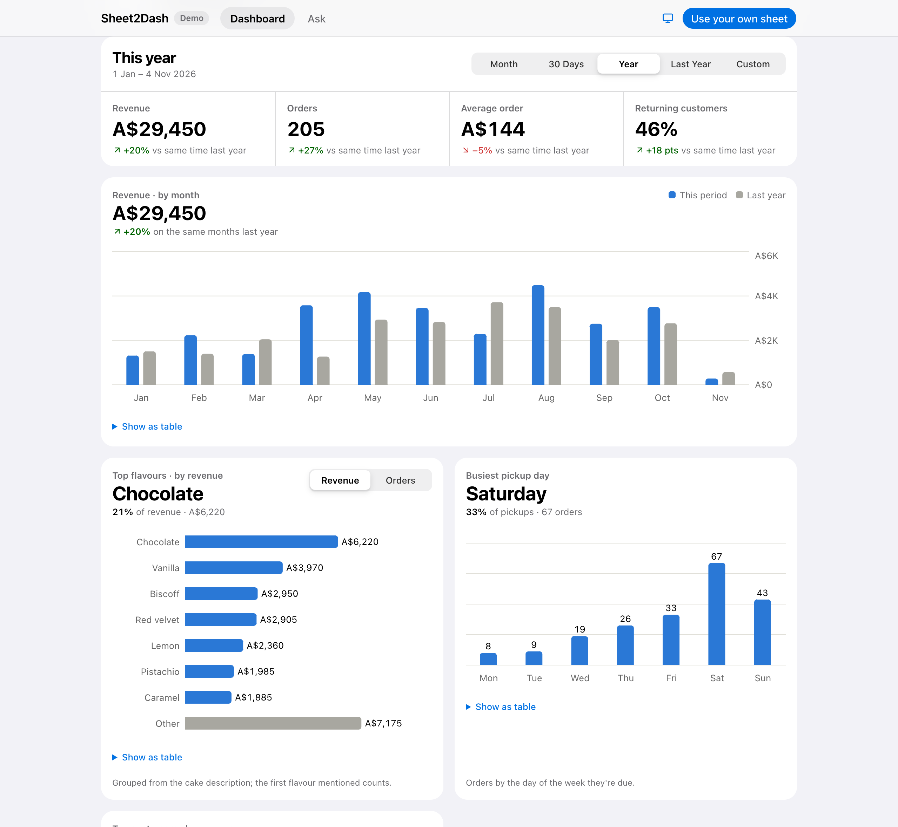
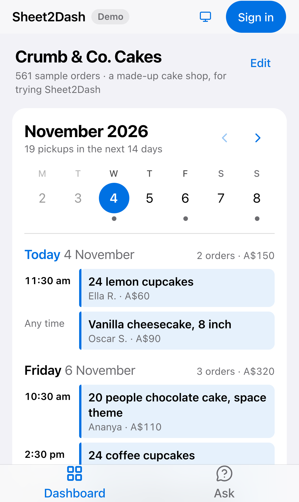
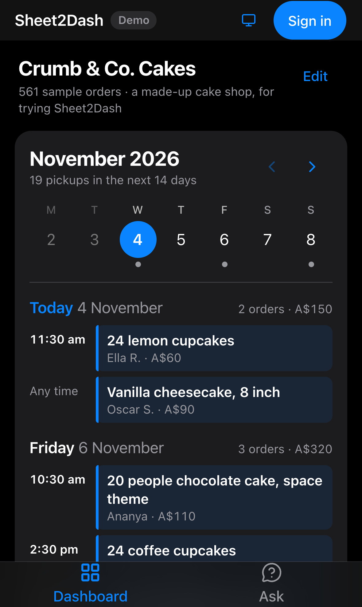
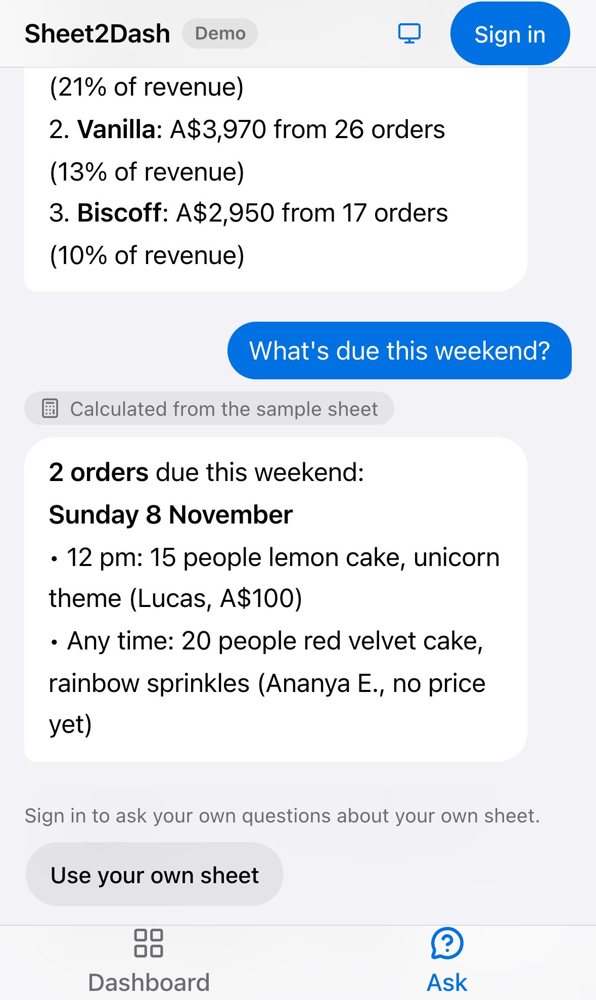
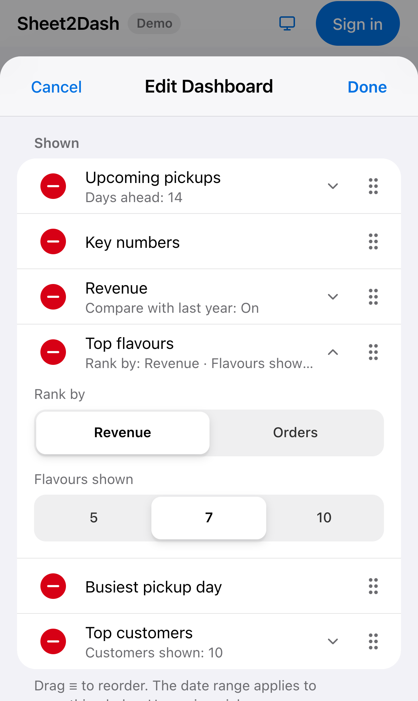

<div align="center">

# Sheet2Dash

**Turn a Google Sheet of orders into a live dashboard, straight from the sheet.**

[Live app](https://sheet2dash.vercel.app) · [Try the demo](https://sheet2dash.vercel.app/demo) (no sign-in) · [Privacy](https://sheet2dash.vercel.app/privacy)


<picture>
  <source media="(prefers-color-scheme: dark)" srcset="docs/screenshots/dashboard-dark.png">
  
</picture>

</div>

Sheet2Dash connects to an orders spreadsheet in Google Sheets and builds a dashboard from it:
upcoming pickups, revenue, best sellers, busiest days, top customers, and a chat that answers
questions about the orders. It reads the sheet as people actually keep it (a tab per year,
free-text descriptions, prices filled in later, times like "5:30-6pm" or "Evening") so nobody
has to change how they work, and the dashboard stays up to date as new orders go in.

<table>
  <tr>
    <td align="center" width="25%"><br><sub>Upcoming pickups</sub></td>
    <td align="center" width="25%"><br><sub>Dark mode</sub></td>
    <td align="center" width="25%"><br><sub>Ask about the orders</sub></td>
    <td align="center" width="25%"><br><sub>Edit the dashboard</sub></td>
  </tr>
</table>

## Features

- **Connect a sheet in two clicks.** Sign in with Google, then pick the spreadsheet in Google's
  file picker. The app can only open that one file (the `drive.file` permission), and only
  reads it.
- **Works with a real, messy sheet:**
  - Merges the year tabs (2022, 2023, …), lining up columns by name even when they differ
    between years.
  - Guesses which column holds the due date, price, pickup time, item and customer, and shows
    a preview for the owner to confirm.
  - Reads dates as serial numbers or DD/MM/YYYY, and prices as numbers or text.
  - Reads pickup times as written: "10am", "5:30-6pm", "Morning", "Evening", or a bare "4".
- **Upcoming pickups** in a Calendar-style view: a swipeable week strip and every day's orders
  stacked below, including orders that don't have a price yet.
- **Period dashboard:**
  - Ranges: this month, last 30 days, this year, last year or a custom range.
  - Key numbers: revenue, orders, average order and returning customers, each compared with
    the previous period and the same time last year.
- **Charts** for revenue (bars against last year), top flavours, busiest pickup days and top
  customers:
  - Each card states its main finding in a sentence.
  - Every chart can also be shown as a table.
  - Flavours are grouped from the free-text descriptions.
- **Ask:** questions in plain English ("How did last month compare with the month before?").
  - The model never does arithmetic. It calls tools that calculate from the sheet, so its
    numbers match the dashboard.
  - Each user has a daily cap on questions.
- **Edit the dashboard:** hide, add back and reorder widgets, and set options per widget
  (days ahead, last-year comparison, how many flavours or customers to show).
- **Read-only sharing:** the owner adds an email address, and that person signs in and sees the
  same dashboard without needing access to the sheet.
- **Always live:** refreshes every minute while the tab is open, with a manual Refresh that
  bypasses the cache.
- **Designed to Apple's Human Interface Guidelines:**
  - System font and iOS type scale; 44 pt touch targets.
  - A tab bar on phones, segmented controls and a translucent header.
  - Light and dark mode, with Reduce Motion, Reduce Transparency and Increase Contrast
    respected.
  - Every text colour checked for at least 4.5:1 contrast.
- **Public demo:** a made-up shop with about 600 generated orders anchored to today, so the
  calendar always has pickups. Edit works in the browser only, and Ask answers the suggested
  questions from the sample data without an AI call.

## Tech

| | |
| --- | --- |
| Framework | [Next.js 16](https://nextjs.org) (App Router, Cache Components, server actions), React 19, TypeScript |
| Auth | [Clerk](https://clerk.com) with Google sign-in; Google tokens fetched server-side |
| Data | Google Sheets API (`batchGet`), Google Picker; [Neon](https://neon.tech) Postgres via [Drizzle](https://orm.drizzle.team) |
| UI | Tailwind CSS 4, [shadcn/ui](https://ui.shadcn.com) (Base UI), [Recharts](https://recharts.org), Lucide icons |
| AI | [Vercel AI SDK](https://ai-sdk.dev) with OpenAI (`gpt-5.4-nano` by default) and tool calling |
| Hosting | [Vercel](https://vercel.com) |

## How it works

1. **Connect.** The browser opens Google Picker with a short-lived token that only carries
   `drive.file`. The server re-reads the picked file's name from Google rather than trusting
   the browser, then saves the link.
2. **Read and merge.** `lib/google/sheets.ts` fetches every year tab in one request and merges
   them. The result is cached per owner for about 30 seconds (`"use cache: remote"` with a tag),
   so the dashboard is fast and Refresh can clear it.
3. **Understand.** `lib/orders.ts` maps columns to roles and parses the rows into typed orders.
   Rows that can't be read are counted and reported, not silently dropped.
4. **Calculate.** `lib/metrics.ts` holds pure functions for periods, KPIs, trends, rankings and
   upcoming orders. The dashboard, the chat tools and the demo answers all use the same
   functions, so they always agree.
5. **Show.** The owner's widget layout is stored as a small validated JSON spec
   (`lib/dashboard-spec.ts`). Viewers see the owner's layout read-only.

**Privacy:**
- The sheet's contents are never stored in the database, only cached briefly.
- Only the question and the matching orders are sent to OpenAI.
- The [privacy page](https://sheet2dash.vercel.app/privacy) has the details.

## Running it locally

You need Node 20+, and accounts with Clerk, Neon, Google Cloud and OpenAI (all have free tiers
or cheap usage).

```bash
npm install
cp .env.example .env.local   # then fill it in, see below
npm run db:migrate           # creates the tables in your Neon database
npm run dev                  # http://localhost:3000
```

The demo at `/demo` works without any keys.

### Setting up the services

1. **Google Cloud:**
   - Create a project.
   - Enable the **Google Sheets API**, **Google Drive API** and **Google Picker API**.
   - Configure the OAuth consent screen with the scopes `openid`, `email`, `profile` and
     `.../auth/drive.file`.
   - Create an **OAuth client ID** (Web application) and an **API key** restricted to the
     Picker API, with your site as an HTTP referrer.
   - Add your site (e.g. `http://localhost:3000`) as an authorized JavaScript origin.
   - The project number goes in `NEXT_PUBLIC_GOOGLE_APP_ID`.
2. **Clerk:**
   - Create an application with Google sign-in.
   - Under **SSO connections → Google**, turn on **custom credentials** and paste the OAuth
     client ID and secret.
   - Add Clerk's redirect URI to the Google OAuth client.
3. **Neon:** create a project and copy the connection string into `DATABASE_URL`.
4. **OpenAI:** create an API key for `OPENAI_API_KEY`. Optionally set `OPENAI_MODEL` and
   `CHAT_DAILY_LIMIT` (default 30 questions per user per day).

## Project structure

```
src/
  app/
    page.tsx                 home
    dashboard/               the signed-in app: dashboard, settings, sharing, editor
      chat/                  Ask
    demo/                    public demo (sample data, no sign-in)
    api/chat/route.ts        streaming chat endpoint with tools and a daily cap
    privacy/                 privacy policy
  components/                buttons, cards, segmented control, theme toggle
  db/                        Drizzle schema and client
  lib/
    google/                  token, Sheets fetch and merge, cache
    orders.ts                column detection and parsing
    metrics.ts               periods, KPIs, trends, rankings
    chat-tools.ts            aggregate/list tools for Ask
    dashboard-spec.ts        widget layout, options and validation
    demo-data.ts             seeded sample orders
drizzle/                     SQL migrations
```

## Scripts

| Command | What it does |
| --- | --- |
| `npm run dev` | Development server |
| `npm run build` / `npm start` | Production build and server |
| `npm run lint` | ESLint |
| `npm run db:generate` | Create a migration after changing `src/db/schema.ts` |
| `npm run db:migrate` | Apply migrations to `DATABASE_URL` |
| `npm run db:studio` | Browse the database |
